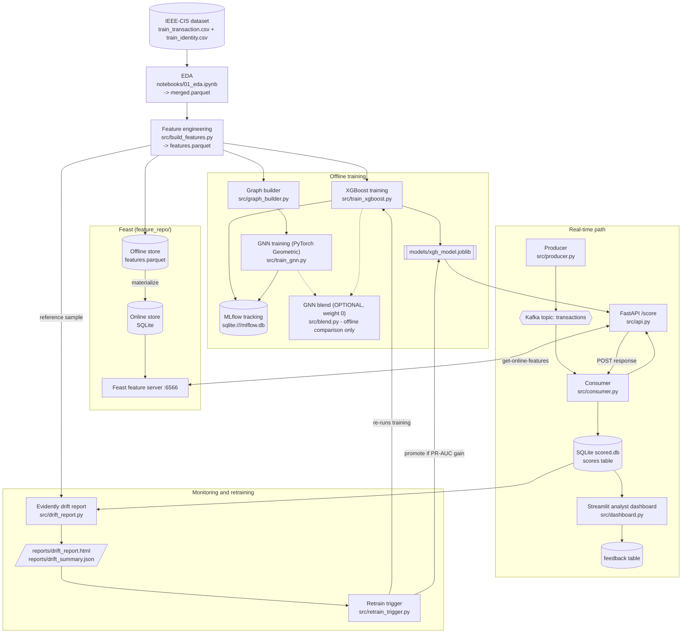
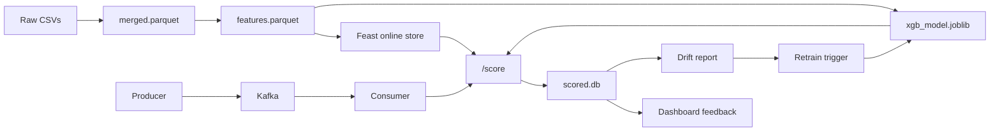

# Architecture

## System diagram

The dotted GNN blend is optional: `src/blend.py` sweeps GNN weights and logs the PR-AUC to MLflow, but the default weight is 0.0 and the API scores with XGBoost only.

## Data flow

## Components

| Component | File | Role |
|---|---|---|
| EDA | `notebooks/01_eda.ipynb` | Joins transaction and identity CSVs into `merged.parquet`. |
| Feature engineering | `src/build_features.py` | Builds card history features into `features.parquet`. |
| Feast | `feature_repo/` | Offline parquet source, SQLite online store, feature server on port 6566. |
| XGBoost training | `src/train_xgboost.py` | Trains the model and logs PR-AUC and the model to MLflow. |
| GNN training | `src/graph_builder.py`, `src/train_gnn.py` | Builds a card-account graph and trains a GCN. |
| GNN blend (optional) | `src/blend.py` | Compares weighted XGBoost + GNN ranks; default GNN weight 0. |
| Producer | `src/producer.py` | Replays validation transactions to the Kafka topic `transactions`. |
| Consumer | `src/consumer.py` | Reads the topic, calls `/score`, writes results to `scored.db`. |
| FastAPI | `src/api.py` | `/score` fetches Feast features and scores with XGBoost. |
| Dashboard | `src/dashboard.py` | Shows scores; analysts save feedback to the `feedback` table. |
| Drift report | `src/drift_report.py` | Evidently compares `scored.db` with a training-period reference sample. |
| Retrain trigger | `src/retrain_trigger.py` | If drift exceeds the threshold in `config/retrain.json`, trains a candidate and promotes it only with enough PR-AUC gain. |

## Data and training

`notebooks/01_eda.ipynb` reads the IEEE-CIS transaction and identity CSV files, joins them on `TransactionID`, and writes `data/processed/merged.parquet`. `src/build_features.py` creates transaction history features and writes `features.parquet`.

`src/train_xgboost.py` combines those features with raw transaction columns, trains on the earlier 80% of the timeline, evaluates on the later 20%, and logs metrics and the model to local MLflow tracking. The separate graph pipeline builds a sampled card-account graph, trains a PyTorch Geometric GCN, and writes account-level scores. `src/blend.py` compares percentile-ranked XGBoost and GNN scores.

## Online scoring and monitoring

The Feast repository uses the feature parquet as an offline file source and SQLite as its online store. Its feature server provides the latest materialized features for a card. FastAPI combines those values with request fields and scores the transaction using the saved XGBoost model. If the Feast lookup is unavailable, the API records that it used default feature values.

The Kafka producer replays validation transactions to the `transactions` topic. The consumer calls the scoring API and stores responses in `data/processed/scored.db`. Streamlit reads the score database and lets reviewers record feedback. Evidently compares scored transactions with a sample from the XGBoost training period; the retraining trigger can train a candidate and promote it when its PR-AUC meets the configured gain.

## Local deployment

`docker/docker-compose.yml` defines the Kafka container. The API, Feast feature server, and Streamlit dashboard can be started as local processes by `scripts/start_all.ps1`; `scripts/stop_all.ps1` stops the services by their listening ports and can also stop Kafka. Dockerfiles for API, dashboard, and Feast are present. The `k8s/` directory currently contains no Kubernetes manifests.
